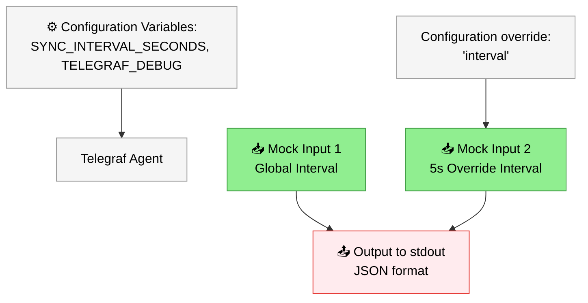

# Hello, World!

> In the of this section there is arrows explaining words that could be hard to understand this will work as a diconary

This is a simple "Hello, world!" project that demonstrates how to use the [FixedIT Data Agent](https://fixedit.ai/products-data-agent/) to print messages to the standard output of the Telegraf process, which will be captured by the FixedIT Data Agent and displayed in the `Logs` tab.

<b>What is Telegraf?</b>

an agent that collects information from computers and systems. This is only possible because of plugins, small building blocks that each handle one specific task

## How it works

The data moves through three stages:

**1. Two inputs create data**

Both inputs use the `inputs.mock` plugin, which generates fake test data.
- The first input creates a "Hello, World!" message plus a random number and a fixed number. It runs on the global interval, which is once per minute by default.
- The second input creates a sine wave every 5 seconds.

**2. One output collects it**

All data is sent to the `outputs.file` plugin, which turns it into JSON text and prints it.

**3. You see it in the Logs tab**

The FixedIT Data Agent captures the printed text and shows it in the **Logs** tab.

Color scheme:

- Light green: Input nodes / data ingestion
- Light red: Output nodes
- Light gray: Configuration and agent

## Why this approach?

Normally, building an app that runs directly on an Axis camera means learning the ACAP SDK and writing C or C++. With the FixedIT Data Agent, you only write a config file, and Telegraf does the rest. This makes it possible for developers, system integrators and IT professionals to build their own automations on the camera.

This project is the smallest possible example: two inputs, one output and nothing else. It's a good starting point for understanding how the agent's configuration works.

<b>What is ACAP?</b>

ACAP (Axis Camera Application Platform) lets you build custom applications that run directly on Axis devices, such as cameras, intercoms and speakers.

<b>What is an SDK?</b>

An SDK (Software Development Kit) is a package of tools, code libraries, documentation and examples that help programmers build software for a specific platform.

