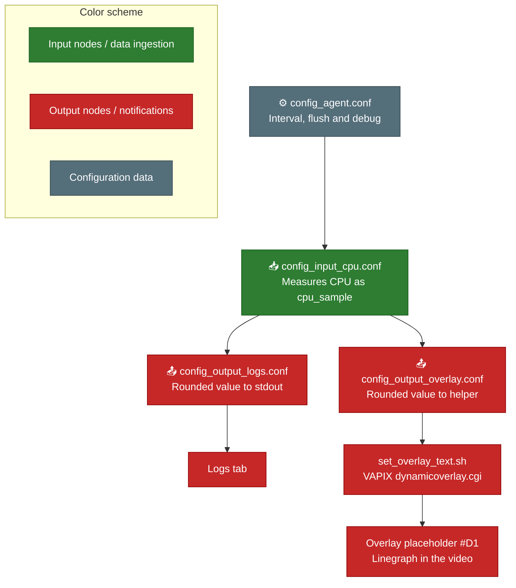

# CPU Usage on Overlay

This project uses the [FixedIT Data Agent](https://fixedit.ai/products-data-agent/) to show the live CPU usage of an Axis camera directly in the video image.

The CPU usage is measured continuously and drawn as a graph in a video overlay, so you can see how hard the camera is working without opening any other tool. The same value is also printed in the Logs tab of the FixedIT Data Agent.

This is useful when a camera runs several applications at the same time, such as analytics or other ACAPs. If the CPU is close to full, the camera can become slow or drop frames, and the graph makes that visible right away.

The project also shows how the FixedIT Data Agent can control the Axis device itself, in this case by updating an overlay, and not only collect data and send it somewhere else.

## How It Works

> You don't need to do anything yet. This section explains what will happen when you follow the setup steps below.

The data flows through three stages:

**1. The CPU usage is measured**

`config_input_cpu.conf` measures the total CPU usage of the camera and names the measurement `cpu_sample`. The name is different from the `cpu` measurement in the bundled configuration files, so the two are not mixed up.

How often the CPU is measured is controlled by `config_agent.conf`, which also sets the flush interval and debug logging.

**2. The value is printed in the logs**

`config_output_logs.conf` rounds the value and prints it to the **Logs** tab. This lets you check that the measurement works before you set up the overlay.

**3. The value is shown in the video**

`config_output_overlay.conf` sends the same rounded value to the `set_overlay_text.sh` helper script. The script uses your VAPIX credentials to call the camera's `dynamicoverlay.cgi` API and updates the overlay placeholder `#D1`. A Linegraph widget in the overlay reads `#D1` and draws the value as a graph.

What is an overlay, and what is #D1?

An overlay is text or graphics placed on top of the video, like the timestamp in the corner of a camera image.

`#D1` is a placeholder for dynamic text. Whatever the script writes to it is shown wherever `#D1` is used in the overlay, in this case as the data source for the Linegraph widget.

## Why Choose This Approach?

**No C/C++ development required!** Showing live data in the video image would normally mean writing an ACAP application that talks to the camera's overlay API in C or C++.

With the [FixedIT Data Agent](https://fixedit.ai/products-data-agent/), a few configuration files and one shell script do the same job. If you want to update the graph more often, or show something other than CPU usage, you edit a configuration file and upload it again, with nothing to compile or install. This makes the solution accessible to system integrators and IT professionals, not only embedded developers.

## Table of Contents

Show / Hide Table

<!-- toc -->

- [CPU Usage on Overlay](#cpu-usage-on-overlay)
- [How It Works](#how-it-works)
- [Why Choose This Approach?](#why-choose-this-approach)
- [Compatibility](#compatibility)
  - [AXIS OS Compatibility](#axis-os-compatibility)
  - [FixedIT Data Agent Compatibility](#fixedit-data-agent-compatibility)
- [Quick Setup](#quick-setup)
- [Troubleshooting](#troubleshooting)
- [Files](#files)
- [Configuration Details](#configuration-details)
- [Local Testing on Host](#local-testing-on-host)
  - [Prerequisites](#prerequisites)
  - [Host Testing Limitations](#host-testing-limitations)
  - [Test Commands](#test-commands)

<!-- tocstop -->

## Compatibility

### AXIS OS Compatibility

- **Minimum AXIS OS version**: TODO
- **Required tools**: Uses `curl` with digest authentication support.
- **Other notes**: Uses digest authentication to call the VAPIX `dynamicoverlay.cgi` API on the camera itself. Requires a camera account with at least **operator** access. Use an account with no higher access than needed.

### FixedIT Data Agent Compatibility

- **Minimum Data Agent version**: TODO
- **Required features**: Uses the VAPIX credentials (`VAPIX_USERNAME` and `VAPIX_PASSWORD`) set in the FixedIT Data Agent, which is currently a beta feature.