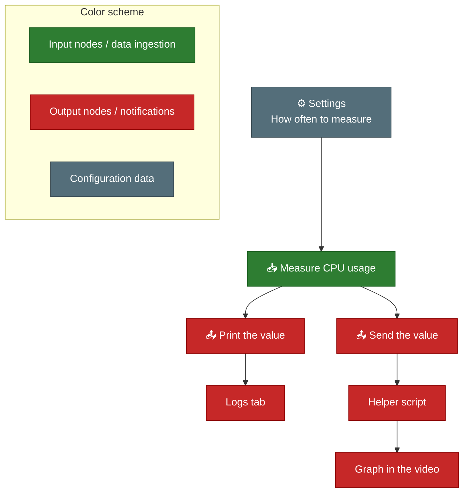

es the value to the overlay, so the graph can show it.
# CPU Usage on Overlay

This project shows how hard your Axis camera is working, as a live graph directly in the video image.

It uses the [FixedIT Data Agent](https://fixedit.ai/products-data-agent/) to measure the camera's CPU usage, and draws the value on top of the video. The same value is also shown in the Logs tab of the FixedIT Data Agent.

This is useful when the camera runs several applications at the same time. If the CPU is close to full, the camera can become slow or drop frames, and the graph shows it right away.

## How It Works

> You don't need to do anything yet. This section explains what will happen when you follow the setup steps below.

The CPU value goes through three stops:

**1. The camera measures its CPU usage**

The FixedIT Data Agent checks how busy the camera's processor is, every 10 seconds by default.

**2. The value is shown in the logs**

The value is printed in the **Logs** tab. This is your first check: if you see the value here, the measurement works.

**3. The value is drawn in the video**

A small helper script sends the value to the camera, which shows it as a graph on top of the video.

> Measure → Logs tab → Graph in the video

What is an overlay?

An overlay is text or graphics placed on top of the video, like the timestamp in the corner of a camera image. In this project, the overlay is a graph of the CPU usage.

Which file does what?

| Stop | File |
|---|---|
| How often the CPU is measured | `config_agent.conf` |
| 1. Measure the CPU usage | `config_input_cpu.conf` |
| 2. Show the value in the logs | `config_output_logs.conf` |
| 3. Send the value to the overlay | `config_output_overlay.conf` and `set_overlay_text.sh` |

See [Configuration Details](#configuration-details) for how each part works.

## Why Choose This Approach?

**No C/C++ development required!** Normally, showing your own data in the video image means building a complete camera application from scratch, written in C or C++.

With the [FixedIT Data Agent](https://fixedit.ai/products-data-agent/), you only upload a few files. Want the graph to update more often, or show something else than CPU usage? You change a file and upload it again. Nothing to build, nothing to install.

What is an ACAP application?

ACAP (Axis Camera Application Platform) is the way to build your own applications that run directly on Axis devices. The FixedIT Data Agent is itself an ACAP, which is why you don't need to build one.

## Table of Contents

Show / Hide Table

<!-- toc -->

- [CPU Usage on Overlay](#cpu-usage-on-overlay)
- [How It Works](#how-it-works)
- [Why Choose This Approach?](#why-choose-this-approach)
- [Compatibility](#compatibility)
  - [AXIS OS Compatibility](#axis-os-compatibility)
  - [FixedIT Data Agent Compatibility](#fixedit-data-agent-compatibility)
- [Quick Setup](#quick-setup)
- [Troubleshooting](#troubleshooting)
- [Files](#files)
- [Configuration Details](#configuration-details)
- [Local Testing on Host](#local-testing-on-host)
  - [Prerequisites](#prerequisites)
  - [Host Testing Limitations](#host-testing-limitations)
  - [Test Commands](#test-commands)

<!-- tocstop -->

## Compatibility

> Check this before you start, so you know that your camera can run the project.

### AXIS OS Compatibility

- **Minimum AXIS OS version**: TODO
- **Required tools**: `curl`
- **Other notes**: You need a camera account with at least **operator** access. Use an account with no higher access than needed.

### FixedIT Data Agent Compatibility

- **Minimum Data Agent version**: TODO
- **Required features**: The **VAPIX credentials** setting, which is currently a beta feature.

What is VAPIX, and why is an account needed?

VAPIX is Axis's API for controlling cameras. The helper script in this project uses it to update the overlay, and the camera only allows that for a logged-in account.

The FixedIT Data Agent passes the account you enter to the script as `VAPIX_USERNAME` and `VAPIX_PASSWORD`. The script then logs in with digest authentication, which means the password is never sent in plain text, and calls the camera's `dynamicoverlay.cgi` API.

## Quick Setup

### Step 1 of 6 – Disable the bundled configuration files

**Goal:** make sure only this project's data is used.

Under **Configuration → Files** in the FixedIT Data Agent, you disable the bundled configuration files. They measure the CPU in their own way, and the two would get mixed up.

**How you know it worked:** the bundled configuration files are shown as disabled.

---

### Step 2 of 6 – Add a camera account

**Goal:** allow the helper script to update the overlay.

In the **VAPIX credentials** section, you turn off the **Clear all values** slider and enter the username and password of a camera account with at least **operator** access. Use an account with no higher access than needed.

Not sure what VAPIX is? See [What is VAPIX, and why is an account needed?](#fixedit-data-agent-compatibility)

**How you know it worked:** the username is saved in the **VAPIX credentials** section.

---

### Step 3 of 6 – Upload the helper script

**Goal:** give the FixedIT Data Agent the script that draws the graph.

You press **Upload helper file**, select `set_overlay_text.sh` and check **Make Executable**.

**How you know it worked:** `set_overlay_text.sh` is listed among the helper files.

---

### Step 4 of 6 – Upload and enable the configuration files

**Goal:** start measuring the CPU and sending the value.

Under **Configuration → Files**, you press **Upload Config** and upload all four `.conf` files:

- `config_agent.conf`
- `config_input_cpu.conf`
- `config_output_logs.conf`
- `config_output_overlay.conf`

Then you press **Enable** next to each of them.

**How you know it worked:** all four files are listed and enabled.

---

### Step 5 of 6 – Check the logs

**Goal:** make sure the CPU is being measured, before you set up the graph.

You open the **Logs** tab.

**How you know it worked:** you see blue lines with the current CPU usage.

> The first value takes about 20 seconds to appear. This is normal, since the CPU has to be measured twice before a percentage can be calculated.

---

### Step 6 of 6 – Add the graph to the video

**Goal:** show the CPU usage as a graph on top of the video.

In the camera's web interface, you go to **Video → Overlays**, add a new **Linegraph** overlay widget and set its data source to `#D1`.

`#D1` is the spot where the helper script writes the CPU value, so the graph knows where to read it.

**How you know it worked:** a graph of the CPU usage appears in the video and is updated every 10 seconds.

## Troubleshooting

Most problems can be found by checking the **Logs** tab. Enable the `Debug` option in the FixedIT Data Agent for detailed logs.

**Note**: Don't leave debug enabled long-term as it creates large log files.

No CPU values in the Logs tab

- Wait about 20 seconds. The first value always takes a little while.
- Check that all four `.conf` files are uploaded and enabled.
- Check that the bundled configuration files are disabled.

CPU values in the logs, but no graph in the video

When the values show up in the logs, the measurement works, and the problem is in the graph part.

- Check that the Linegraph widget uses exactly `#D1` as its data source.
- Check that `set_overlay_text.sh` was uploaded with **Make Executable** checked.
- Look in the Logs tab for messages that start with `set_overlay_text.sh:`.

Error: VAPIX_USERNAME and VAPIX_PASSWORD must be set

The helper script could not find a camera account. Go back to [Step 2](#step-2-of-6--add-a-camera-account), add a username and password, and make sure the **Clear all values** slider is turned off.

Error: set_overlay_text.sh: request failed

The script reached the camera, but the camera said no.

- Check that the username and password are correct.
- Check that the account has at least **operator** access.

## Files

- `config_agent.conf` - How often the CPU is measured, and debug logging.
- `config_input_cpu.conf` - Measures the CPU usage.
- `config_output_logs.conf` - Shows the value in the Logs tab.
- `config_output_overlay.conf` - Sends the value to the helper script.
- `set_overlay_text.sh` - Writ
See [Configuration Details](#configuration-details) for how each file works.