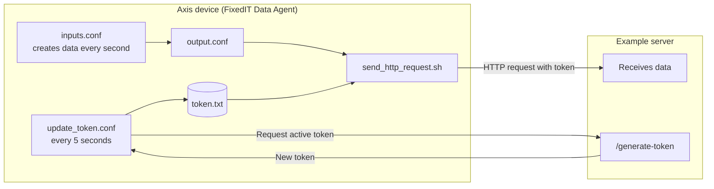

# Example of token rotation for the FixedIT Data Agent

When sending data to the cloud from the FixedIT Data Agent, we might want to use token rotation, so that any specific token is not used for too long.

This project was created during a screencast that can be found [here](https://www.youtube.com/watch?v=zeWdbDNvj_w).

**After this guide, you can:** send data from an Axis device to a server, using a new token every 5 seconds.



<details>
<summary><b>Table of contents</b></summary>

- [What is token rotation?](#what-is-token-rotation)
- [How it works](#how-it-works)
- [Quick start](#quick-start)
- [For those who want to know more](#for-those-who-want-to-know-more)

</details>

---

## What is token rotation?

A token works like a password that the device sends with each request, so that the server knows who it is.

If the same token is used for a long time and someone gets hold of it, they can use it for just as long. With token rotation, the token is replaced often, so a stolen token quickly stops working.

---

## How it works

> You don't need to do anything yet. This section explains what will happen when you follow the steps below.

**1. The device gets its first token**

From the start, all devices share a bootstrap token. The first time a new device connects to the server, it is issued a new token.

After this, the bootstrap token will no longer be accepted by the server for this particular device.

**2. The device keeps its token fresh**

The device has a workflow that requests the latest active token from the server's `/generate-token` endpoint every 5 seconds.

The workflow saves this token to the `${HELPER_FILES_DIR}/token.txt` file.

**3. The device sends data with the current token**

All workflows on the device that send data to the server use the `send_http_request.sh` script. It reads the token from `token.txt` and uses it to authenticate the request.

> Bootstrap token → first token → new token every 5 seconds → data sent with the current token

---

## Quick start

### Step 1 of 4 – Start the example server

**Goal:** have a server ready to receive data and hand out tokens.

On a computer with Python installed, start the example server:

```bash
python test_scripts/example_server.py
```

**How you know it worked:** the server is running and waiting for connections in the terminal.

> TODO: check that this is the correct way to start the server.

---

### Step 2 of 4 – Point the device to the server

**Goal:** tell the device where the server is and which bootstrap token to use.

Set the `Extra env` parameter in the FixedIT Data Agent to:

```
SERVER_URL=my.server.address;BOOTSTRAP_TOKEN=bootstrap-key-12345
```

Replace `my.server.address` with the hostname or IP address of the computer running the example server.

The `BOOTSTRAP_TOKEN` matches the example token that is currently hardcoded in `example_server.py`.

> **Note:** the bootstrap token is hardcoded for this example only. Don't use it for real deployments.

---

### Step 3 of 4 – Upload the helper script

**Goal:** give the device the script it uses to send data with the current token.

1. Press **Upload Helper File** in the top right corner of the FixedIT Data Agent.
2. Select `send_http_request.sh`.
3. Check **Make executable**.

**How you know it worked:** `send_http_request.sh` is listed among the helper files.

---

### Step 4 of 4 – Upload and enable the config files

**Goal:** start creating data, refreshing the token and sending the data.

1. Press **Upload Config** in the top right corner and upload `inputs.conf`, `output.conf` and `update_token.conf`.
2. Press **Enable** next to each of the three files.

**How you know it worked:** the example server's terminal shows data arriving every second.

<details>
<summary>Nothing showing up in the server terminal?</summary>

- Check that `SERVER_URL` is the correct address of your computer.
- Check that the device and the computer can reach each other on the network.
- Check that **Make executable** was checked for `send_http_request.sh`.
- Check that all three config files are enabled.

</details>

